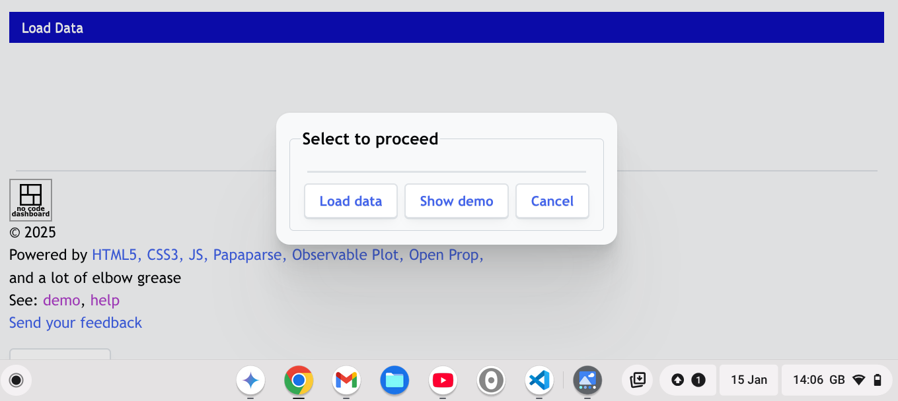
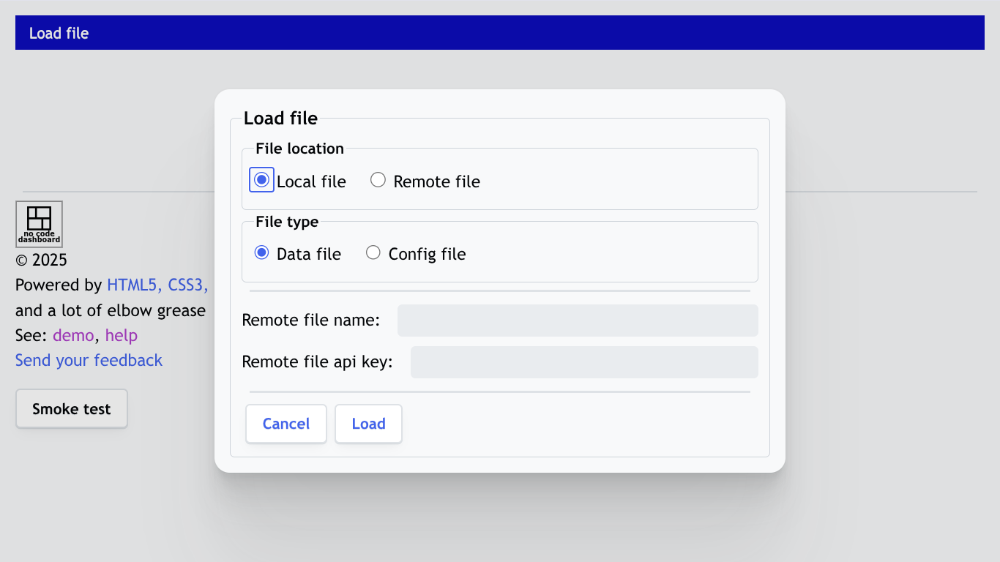

# No-code-dashboard Help

## What is No-code-dashboard?

No-code-dashboard is a web app designed to **instantly transform raw data into professional-quality visual insights**.

The process is simple: you provide a standard CSV file, and the App immediately renders your data as a set of callouts and interactive charts.

You can slice and dice the information in these charts to perform in-depth analysis. Click directly on any bar within a chart to instantly filter all visuals on the screen, allowing you to isolate and focus on specific data segments (for example, viewing sales data for a single region or product).

The first dashboard is built in seconds, just by loading data, and can then be easily configured. The App does not require any specialist skills, equipment or software other than an internet connection and the App itself. It allows the data held in collaborative tools (such as Jira, DevOps, ServiceNow, HP/QC and good old Excel) to be the single source of truth, so all stakeholders, from executives to PMs to developers and testers, use the same data to make decisions.

The App is based on years of experience building dashboards that successfully support projects large and small.

## How to use the App

When the App starts up, it presents a dialog to select **Load data** or **Show demo**:

**Load data** allows you to load a data or config file as described [here](#load-file). Once data is loaded, the [menu items](#menu-items) appear at the top of the screen, followed by callouts and charts. If a data file is selected, the input is expected to be a CSV (comma-separated values) file.

**Show demo** starts a pre-prepared [demo](#what-are-the-demos) to highlight No-code-dashboard.

## Menu items

The main menu at the top of the screen shows the available options. If no data is loaded, only [Load file](#load-file) is available. Once data is loaded, the menu options are as described below.

### Content

Shows a table of contents.

### Load file

The Load file dialog allows you to select local or remote, and data or config, files:

When data is loaded for the first time, a config is created automatically, which can be modified as described [later](#configure-dashboard). If data is loaded while a dashboard is already visible, the App checks whether the current config is applicable (that is, the column names and types match the data being loaded). The App's action depends on the situation:

| Config is present | App action |
|---|---|
| No | Creates a config based on the data and loads the data|
| Yes | Asks whether the current config should be used or overwritten, and acts accordingly |

If a config file is selected, the input is expected to be JSON, preferably [saved](#save-config) previously by the App.

| Config with data file defined |App action |
|---|---|
| Yes | Loads the config and the data referred to in the config. This is useful when a dashboard has been authored for distribution to others |
| No | Stores the config for a subsequent data load |

### Configure dashboard

This menu option allows you to modify the dashboard layout, such as the report title and report date. Callouts and charts can be modified as described [later](#how-to-configure-the-dashboard).

### Save config

Allows you to download the current config so you can use the file later.

> **Note:** Downloads do not work consistently in all browsers. If the download is unsuccessful, the config is copied to the clipboard. As a workaround, open a new text file, paste the config and save the file.

In [demo mode](#what-are-the-demos), a list of predefined options is shown between the table of contents and Print PDF.

## How to configure the dashboard

The dashboard can be modified in three ways:

| Dashboard component | Details |
|---|---|
| [Layout](#configure-dashboard) | Modify the dashboard layout, such as the report title and report date |
| [Charts](#how-to-configure-charts) | Modify individual charts (see below) |
| Callouts | To do |

## What is a Chart menu?

In the top-right corner of every chart there is a hamburger menu. Clicking it offers the following options:

| Menu option | Description |
|---|---|
| Filter Chart | Shows all the values on the x-axis so you can select which to show (checked) or hide (unchecked). This option is only shown for charts that are filterable |
| [Config Chart](#how-to-configure-charts) | Lets you change the chart as you see fit. This is described in detail in a separate section |
| Remove Chart | Deletes the chart. The App asks for confirmation before deleting |
| Clone Chart | Adds a copy of the chart at the current position. Once copied, you can change its config |
| Close | Closes the menu |

## How to configure charts

In the top-right corner of every chart there is a hamburger menu. Clicking it offers a number of options, including one to configure the chart; all available options are described [here](#what-is-a-chart-menu).

When **Config Chart** is clicked, the App shows a dialog with the chart attributes. The top of the dialog shows the attributes common to all charts, followed by the attributes specific to the chart type. A dialog for a [bar chart](#chart-type-bar) is shown below:

<!-- Image of the bar chart config dialog to be added -->

The common attributes are:

| Common attribute | Description |
|---|---|
| Chart title | Lets you change the title of a chart. If left blank, the placeholder shows the default title. It is recommended that you keep this blank while you are configuring the charts, and enter a title afterwards only if you want to override the default |
| Chart size | Can be `small`, `medium` or `large`. On larger screens, such as a PC or laptop, the three sizes display as expected. On a smaller screen, such as a mobile, all charts show in one size |
| Chart position | Allows you to re-position a chart. Select a new position and the App moves the chart there |
| Chart type | Select a chart type and the App refreshes the chart-specific attributes for possible modification. See the table below for a summary of the chart types |

The configurable attributes depend on the **Chart type**. A summary of all chart types is shown below; the attributes for each type are described in later sections. Click a chart type in the first column to jump to its chart-specific attributes.

| Chart type | Description |
|---|---|
| [Bar](#chart-type-bar) | A column chart, perhaps the most familiar chart type |
| [2x2](#chart-type-2x2) | Shows cross-tabulated data for two columns |
| [Note](#chart-type-note) | Lets you add a message to the dashboard. It is not a chart, but is useful for embedding key messages. The demos use these to describe the charts |
| [Data Description](#chart-type-data-description) | Describes the input data in a table showing data type, counts, and maximum and minimum values |
| [Data Table](#chart-type-data-table) | Lists the first and last *n* rows of the input data |
| [Plan](#chart-type-plan) | A specialist chart that shows the data as a Gantt chart |
| [Risk](#chart-type-risk) | A specialist chart that displays data in a 5x5 risk matrix |
| [State Change](#chart-type-state-change) | A specialist chart that shows transition times between different states |
| [Trend](#chart-type-trend) | Shows the trend of values, for example a test execution trend |

## Chart type 2x2

This chart shows cross-tabulated data for two columns, specified for the horizontal (x) and vertical (y) axes. You can select the attributes for each axis as follows:

| Attribute | Description |
|---|---|
|Horizontal axis||
| Column | Specifies the column used as the horizontal axis |
| Data type | Is always `string` |
|Categories|See [datat type string](#string) for detail|
| Axis label | The label for the horizontal axis. If left blank, no label is shown, which makes the chart more compact |
|Vertical axis||
Identical to horizontal axis||
| Chart filter | See [Chart filter](#chart-filter) for details |
| Count type | See [Count type](#count-type) for details |

## Chart type Bar

This is the same as a column chart, perhaps the most familiar chart type.

The chart-specific attributes are:

| Attribute | Description |
|---|---|
|Horizontal axis||
| Column | Specifies the column used as the horizontal axis |
| Data type | Is always `string` or `list`, and specifies how the data is aggregated. These data types are explained below |
| Axis label | The label for the horizontal axis. If left blank, no label is shown, which makes the chart more compact |
| Chart filter | See [Chart filter](#chart-filter) for details |
| Count type | See [Count type](#count-type) for details |

The data types are as follows.

### Date

Date is used when the x-axis has date values.

The App expects date fields to be in `DD-MMM-YYYY` or `YYYY-MM-DD` format, to avoid misinterpreting American and European date formats.

You can select the column to show on the x-axis. The available formats are:

| Format | Description |
|---|---|
| `DD` | Day of the month, e.g. 01, 02... 31 |
| `DDD` | Day of the week, e.g. Mon, Tue... Sun |
| `MMM` | Short month, e.g. Jan, Feb... Dec |
| `MMM-YY` | Month in a year, e.g. Jan-25 |
| `YYYY` | Four digit year, e.g. 2025, 2026,... |
| `W8` | 8 weeks after the report date |
| `8W` | 8 weeks before the report date |
| `4W4` | 4 weeks on either side of the report date |

### Number

Number is used when the x-axis has numbers. You can enter `bin` to show the chart by bin values. The bin, if entered, must be a single number or an ascending comma-separated list of numbers. If a single number, *n*, is entered, the App distributes the numbers into *n* bins. If a list is entered, the bin boundaries are set accordingly.

### String

String is used when the axis is a string. You can define order of categories the chart axis is displayed. For example, if `Build, Test, Deploy` is entered for ***Categories***, the chart will show these categories in that order, followed by any others present in the data. ***Categories*** is also useful for showing specific values even when they are absent from the data. For instance, to show P1 even if its count is zero, enter `P1` in ***Categories***.

### List

TBD
**List Count** is useful when a column contains a list of values, for example a list of tags or a list of defects linked to a test script. You indicate a separator for the list, such as a comma; the separator defaults to a space if not provided. You can further define the count-if value as described in [Count type](#count-type).

**List Members** is also useful when a column contains a list of values. The chart shows the count of each tag in the input. You can further define the count-if value as described in [Count type](#count-type).

## Chart type Data Table

This displays the rows of the input data. You can select the number of rows to display.

## Chart type Data Description

This describes the attributes of the input data in a table, i.e. data type, counts, and maximum and minimum values.

There are no chart-specific attributes.

## Chart type Note

**Note** lets you add a message to the dashboard. It is not a chart per se, but is very useful for embedding key messages. You enter a ***Text*** in markdown, which is shown in the chart.

The [demos](#what-are-the-demos) use these to describe the dashboards.

## Chart type Plan

This shows the data as a Gantt chart. The required inputs are a column containing the description to show in the plan, a column for the start date and a column for the end date. The start and end date columns must contain dates. You can further define count-if as described in [Count type](#count-type). The chart-specific attributes are:

| Attribute | Description |
|---|---|
| Description column | Column containing the description of the activity |
| First set of dates||
| Start date column | Column containing the start date of the activity |
| End date column | Column containing the end date of the activity |
| Label | Describes how the second set of dates is labelled. Defaults to `Plan` |
| Second set of dates (optional) | |
| Start date column | Column containing the start date of the activity |
| End date column | Column containing the end date of the activity |
| Label | Describes how the second set of dates is labelled. Defaults to `Actuals` |
| **RAG (optional)** | |
| RAG column | Column from which the data for the RAG colour is picked up |
| RAG map | A mandatory field that maps input values to an integer, which is used to calculate likelihood and impact. Enter five comma-separated values, which are interpreted as numbers based on their relative position. For example, `VL,LO,MED,HI,VH` means VL is 1 and MED is 3 |
| Chart filter | See [Chart filter](#chart-filter) for details |
| Annotations | See [Annotations](#annotations) for details|

## Chart type Risk

This chart displays data in a standard 5x5 risk matrix. You select the likelihood and impact columns; the App expects values from 1 to 5 in these columns. You can also define the likelihood and impact values. Average/sum and count-if options are available, as described in [Count type](#count-type). The chart-specific attributes are:

| Attribute | Description |
|---|---|
|| To do |

For Impact enter 10 comma-separated values representing 5 pairs of data-value, display-value ordered from lowest to highest severity. The app automatically assigns a score from 1 to 5 based on each pair's position.  The chart shows the corresponding display-value for the data-values.

For Likelihood, enter 10 comma-separated values representing 5 pairs of data-value, display-value ordered from lowest to highest probability. The app automatically assigns a score from 1 to 5 based on each pair's position. The chart shows the corresponding display-value for the data-values.

## Chart type State Change

This chart shows transition times between different states. You select the columns from which the App picks the values: Time stamp gives the time of the transition, while From and To give the values at the point of transition. You can count the number of transitions, or calculate the total or average time of transition. The chart-specific attributes are:

| Attribute | Description |
|---|---|
| To do | To do |

The App expects the data source to be sorted in ascending order of ID and timestamp.

## Chart type Trend

This shows the trend of values, for example a test execution trend. You must specify a date column. You can further define count-if, plan and forecast values as described in [Common elements](#common-elements). The chart-specific attributes are:

| Attribute | Description |
|---|---|
| **Horizontal axis** | |
| Column name | Specifies the column used as the horizontal axis. The data type must be date |
| Axis label | The label for the horizontal axis. If left blank, the column name is used |
| Chart filter | See [Chart filter](#chart-filter) for details |
| Plan | See [Plan](#plan) for details |
| Forecast | See [Forecast](#forecast) for details |
| Annotations | See [Annotations](#annotations) |

## Common elements

The following elements are used in more than one type of chart:

| Element | Description |
|---|---|
| Annotations | Allows annotations on the chart |
| Count type | Allows different aggregation methods: counting, summing or averaging |
| Chart filter | Allows you to choose which rows are included in the chart |
| Plan | Allows plotting a plan in Trend charts |
| Forecast | Allows plotting a forecast in Trend charts |

Each of these is described below.

### Annotations

### Count type

Average/sum uses another column, called *column over*, that contains numeric data. The App displays the sum or average of the values from this second column.

### Chart filter

The chart filter decides which input records are included. It is defined by an array of conditions joined by `and`/`or`. Each condition has the following attributes:

| Config item | Description |
|---|---|
| Relational operator | Possible values are `and` and `or`. This decides how the row is connected to the previous row. The value in the first row is ignored |
| LHS | Left-hand side of the comparison. This is always a column, and at run time the column's content is used |
| Logical operator | Possible values are `eq`, `neq`, `in` and `nin` |
| RHS | Right-hand side of the comparison |

### Plan

The App draws a plan line as described below:

| Attribute | Description |
|---|---|
| Start date | Start date of the plan |
| End date | End date of the plan |
| Scope-from | Start number for the plan. Defaults to zero |
| Scope-to | End number for the plan. This can be `Max` (instead of a number), in which case the maximum vertical axis value in the chart is used |
| Points | Can be `Line`, `Sigmoid` or an array of numbers that decides the points plotted. If `Line` is selected, the App draws a straight line. If `Sigmoid` is selected, it draws a curve that rises slowly at the start and end, with a period of rapid rise in between. When an array of numbers is provided, the curve is drawn using the formula: nth point in chart = ***Scope-from*** + (***Scope-to*** − ***Scope-from***) × nth array value. For example, `[0, 1]` draws a straight line from 0 to ***Scope-to*** |

### Forecast

The App draws a forecast line based on the trend over the previous ***look-back*** days, as described below:

| Attribute | Description |
|---|---|
| Look back | The number of days prior to the report date used to calculate the forecast |
| Forecast to | Decides the end point of the forecast. The value can be `max` (forecast until the maximum value is reached) or a specific date indicating the end of the forecast |
| Label | Decides how the forecast is labeled in the chart. If left blank, a default value is used |

## What are the demos?

The demos are based on years of experience successfully building dashboards for projects up to $100M in size. These core principles are embedded directly into the demos, significantly increasing their value to you.
